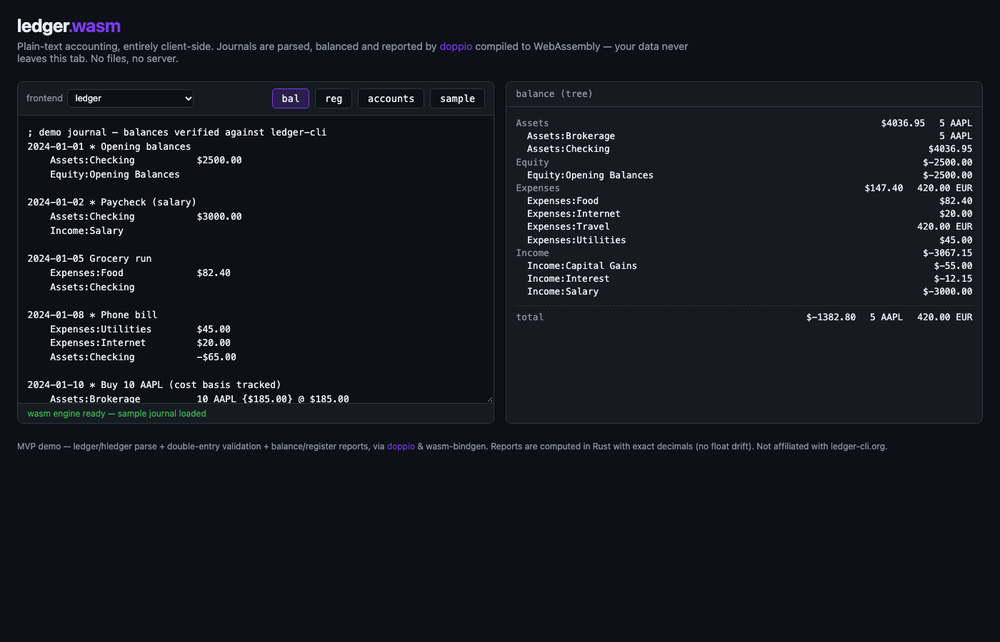

# ledger.wasm — "ledger CLI in the browser" MVP

A static site where you paste a **ledger / hledger / beancount** journal and get
`bal` / `reg` / `accounts` reports computed **entirely client-side** in
WebAssembly. Journals never leave the browser tab.

## How it works

```
 your journal text
        │   paste
        ▼
 ┌───────────────────────────── wasm ─────────────────────────────┐
 │  Engine (this repo, wasm-bindgen crate)                        │
 │   1. doppio parses + elaborates (double-entry validation,      │
 │      balance assertions, cost/lot semantics, null postings)    │
 │   2. report layer folds postings into balance tree / register  │
 │      (rust_decimal — exact arithmetic, no float drift)         │
 └───────────────────┬────────────────────────────────────────────┘
                     │  JSON
                     ▼
        vanilla JS + DOM (web/index.html)
```

- **Parsing/validation**: [doppio](https://github.com/alevy/doppio) 2.4 (the same
  engine behind doppio's compile demo). Unsupported: `include` directives,
  automatic postings, `=` balance assignments.
- **No `.dop` files** anywhere — reports are computed in-memory and returned as JSON.
- Bundle: ~2.6MB uncompressed (wasm + JS glue); gzip transfers ~0.7MB.

## Repo layout

```
src/lib.rs            Engine: doppio parse -> elaborated Journal -> reports
tests/engine.rs       native tests, expectations cross-checked with ledger-cli 3.4.1
web/{index,app,css}.  static frontend, no build step
build-wasm.sh         cargo build + wasm-bindgen + stage dist/ (CLI pin checked)
.github/workflows/deploy.yml    test + build + deploy to GitHub Pages
```

## Local development

```sh
rustup target add wasm32-unknown-unknown
cargo install wasm-bindgen-cli@0.2.117 --locked   # must match Cargo.toml pin
cargo test                                        # engine tests
./build-wasm.sh                                   # -> dist/
python3 -m http.server 8931 --directory dist      # wasm needs http://, not file://
```

Open http://127.0.0.1 — the sample journal loads and balances automatically.



`⌘/Ctrl+Enter` in the editor runs `bal`.

## License

MIT for this repository. The journal parsing/validation engine is
[doppio](https://github.com/alevy/doppio) (MIT), linked as a crates.io
dependency; `wasm-bindgen` and all other dependencies are MIT / Apache-2.0 /
permissive (see `Cargo.lock` metadata). No source from doppio's web frontend
is used — this site's UI is original.

## Deploying (GitHub Pages)

1. Push the repo to GitHub, branch `main`.
2. Repo **Settings → Pages → Source: GitHub Actions**.
3. The `deploy.yml` workflow runs on push (path-filtered), runs the tests, builds
   `dist/`, and deploys to `https://<user>.github.io/<repo>/`.

The workflow pins `wasm-bindgen-cli` to the crate's version, mirroring
[doppio's own CI](https://github.com/alevy/doppio/blob/main/.github/workflows/web.yml)
— a version mismatch between the crate and the CLI fails the build.

## Known limits (MVP)

- No `include` files, auto posts (`=`-rules), budgeting, price-db conversion reports.
- `beancount` frontend works but doppio marks it experimental.
- Balance tree sorting is plain BTreeMap order (alphabetical), not ledger's
  asset/liability ordering.